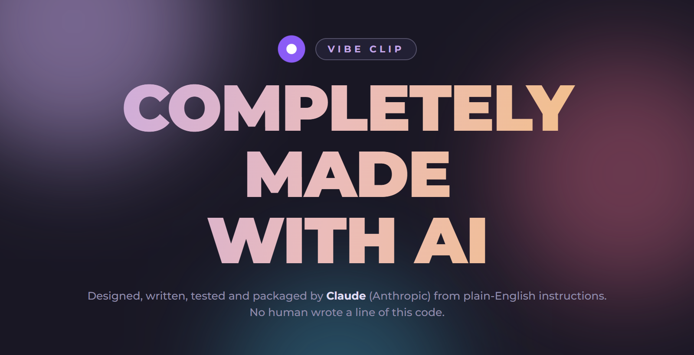
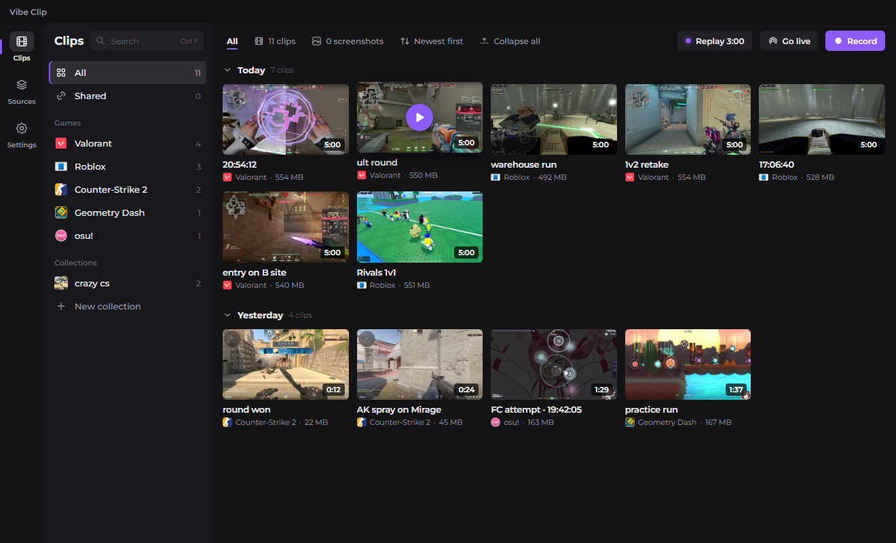
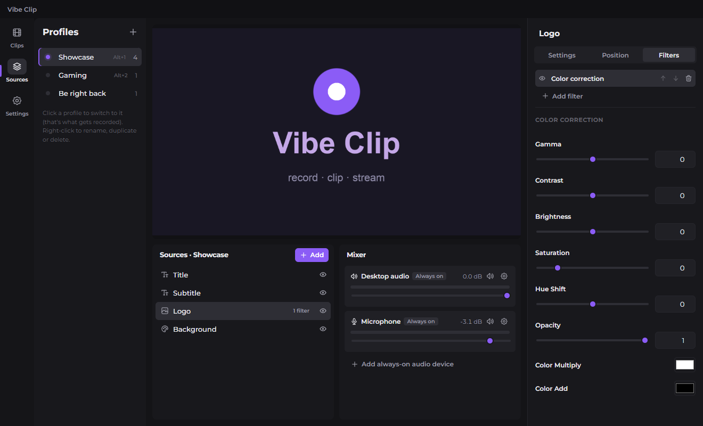
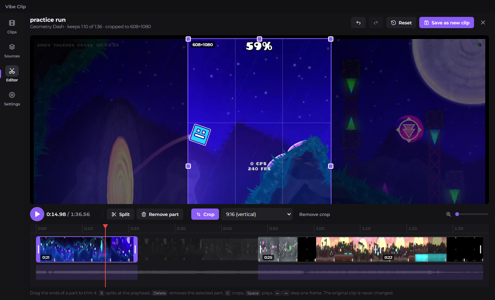
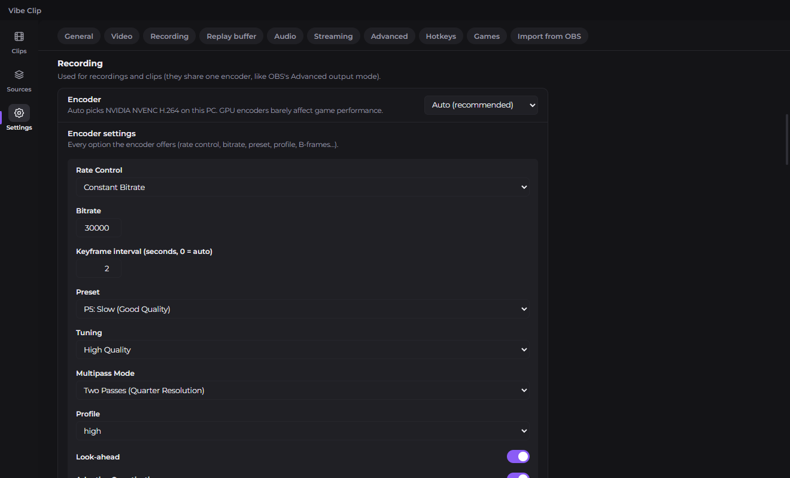
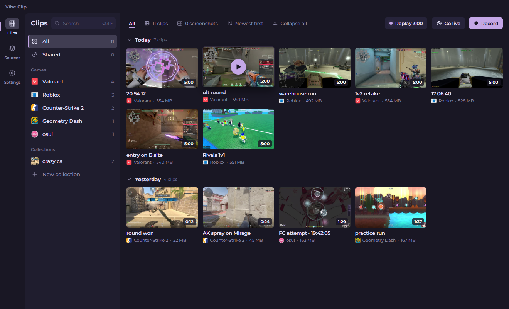

<div align="center">



</div>

<div align="center">

# Vibe Clip

</div>

<div align="center">

A Windows game recorder and clipper with the power of OBS, Medal-style instant clips and a clean clip library  
**Every line of it was written by AI.**

</div>

<div align="center">

[](https://github.com/phsrp/vibe-clip/releases/latest)  

</div>

## What's inside

- **Instant clips:** the replay buffer is always on in the background. Press **Alt+F10** and the last 3 minutes (you choose the length) are saved as a clip, with a small pop-up over your game to confirm it.
- **Recording:** record the whole session with **Alt+F9**. Uses your graphics card's encoder (NVIDIA NVENC, AMD AMF or Intel QuickSync) so your game doesn't slow down, with x264 as a fallback.
- **The OBS engine inside:** Vibe Clip runs on libobs, the same engine as OBS Studio, so you get OBS quality and every OBS option.
- **Games are recognised:** osu!, Counter-Strike 2, Geometry Dash, Valorant and Roblox out of the box, and you can add any game by its .exe name. Clips are tagged and sorted by game, with the game's real icon, and osu! clips are named after the song you were playing.
- **Clip library:** clips grouped by day, game folders with counts, collections, search, rename, delete (to the Recycle Bin) and a built-in player.
- **Screenshots:** **Alt+F12** saves a full-resolution screenshot into the library.
- **Profiles** (what OBS calls scenes): display, window, game capture, webcam, microphones, desktop audio, single-app audio, images, text, browser sources and more. Every source has all of its OBS settings, plus position, crop and filters (green screen, colour correction, noise suppression and every other OBS filter).
- **Audio mixer:** live level meters, volume, mute, monitoring, sync offset, and you choose which of the **6 audio tracks** each source goes to.
- **Built-in editor:** trim, split, remove parts and crop (16:9, 9:16 for shorts, 1:1...), then save as a new clip. The original is never changed.
- **Streaming:** go live on Twitch, YouTube, Kick or any RTMP/WHIP server, with its own encoder settings. Your stream key is stored encrypted.
- **Import from OBS:** bring over your OBS settings (encoder, bitrate, tracks, hotkeys, stream key) and your scenes, which become profiles with their sources, positions, filters and audio routing.
- **Runs in the tray** so the replay buffer keeps going with the window closed, and it can start with Windows
- **Updates itself:** tells you when a new version is out and asks before downloading
- **Themes:** Default Dark, Gruvbox Dark and Rosé Pine

## Previews

<div align="center">



 

 

</div>

## How to download

1. Open the [latest release](https://github.com/phsrp/vibe-clip/releases/latest) (the purple **download** button at the top of this page does the same).
2. Under **Assets**, click `Vibe-Clip-Setup-<version>.exe`.
3. Run the file you downloaded. It installs just for you (no administrator needed), lets you choose the folder, and puts a shortcut on your desktop and in the Start menu.
4. **If Windows says "Windows protected your PC":** the installer is not code-signed yet, so Windows is careful with it. Click **More info**, then **Run anyway**.

### Updating

Vibe Clip checks for a new version each time it opens and asks before downloading it: click **Download**, then **Restart now** (or **Later**, and it installs the next time you quit). **Remind me later** asks again in 4 hours. A recording in progress is always saved before an update installs, and your clips, profiles and settings are kept. You can also check by hand in **Settings → General**.

## Bringing your OBS setup over

Open **Settings → Import from OBS**:

- **Settings (OBS profile):** canvas and output size, frame rate, encoder with all its options, bitrate, recording format, audio tracks, replay buffer, hotkeys, and your streaming service and key.
- **Scenes (OBS scene collection):** every scene becomes a profile, with its sources, positions, crops, filters, volumes and which audio tracks each source goes to.

You see a list of what will be imported (and anything that can't be) before anything changes. Your OBS files are only read.

## Hotkeys

These work everywhere, even while a game has focus. Change them in **Settings → Hotkeys**.

| Key | What it does |
| --- | --- |
| Alt+F10 | Save a clip (the last few minutes) |
| Alt+F9 | Start / stop recording |
| Alt+F12 | Screenshot |
| (not set) | Replay buffer on / off, start / stop streaming, mute the microphone |
| (per profile) | Switch to that profile |

In the editor: **S** splits at the playhead, **Delete** removes the selected part, **C** crops, **Space** plays, **←/→** step one frame, **Ctrl+Z / Ctrl+Y** undo and redo.

## Where your clips go

Clips, recordings and screenshots are saved to `Videos\Vibe Clip\<game>\` (change it in **Settings → General**). They are normal MP4 and PNG files: open, share or move them however you like.

## What the version numbers mean

Every version is three numbers separated by dots, for example **1.0.0**:

```
  1   .   0   .   0
  │       │       └── minor update: fixes and small improvements
  │       └────────── major update: a big batch of new features (counts from 0 to 9)
  └────────────────── goes up by one when the major number would pass 9
```

- **Minor update (the last number)** goes up for small changes: bug fixes, polish, small additions. `1.0.0` → `1.0.1`.
- **Major update (the middle number)** goes up for a big update with new features, and the minor number starts again from 0. `1.0.1` → `1.1.0`. It counts from 0 up to 9.
- **The first number** only changes when the major number runs out: after `1.9.x` the next big update is `2.0.0`.

So a bigger number on the left always means a newer version: `1.0.1` is newer than `1.0.0`, and `1.1.0` is newer than `1.0.9`.

## Built with

- [Electron](https://www.electronjs.org/), [React](https://react.dev/) and [electron-vite](https://electron-vite.org/)
- [OBS Studio](https://obsproject.com/)'s engine (libobs, GPL-2.0) through Streamlabs' [obs-studio-node](https://github.com/stream-labs/obs-studio-node) (GPL-2.0), for capture, encoding, the replay buffer, filters and streaming. Because of this, Vibe Clip is released under the [GPL-2.0](LICENSE) too.
- [FFmpeg](https://ffmpeg.org/) (shipped with obs-studio-node) for thumbnails, converting recordings and editor exports
- [electron-updater](https://www.electron.build/auto-update) for updates
- The editor's timeline is a simplified version of the one in [Vibe Editing Suite](https://github.com/phsrp/Vibe-editing-suite)
- [Montserrat](https://github.com/JulietaUla/Montserrat) font (SIL Open Font License)
- [Tabler Icons](https://tabler.io/icons) (MIT)
- [Rosé Pine](https://rosepinetheme.com/) (MIT) and [Gruvbox](https://github.com/morhetz/gruvbox) (MIT) colours
